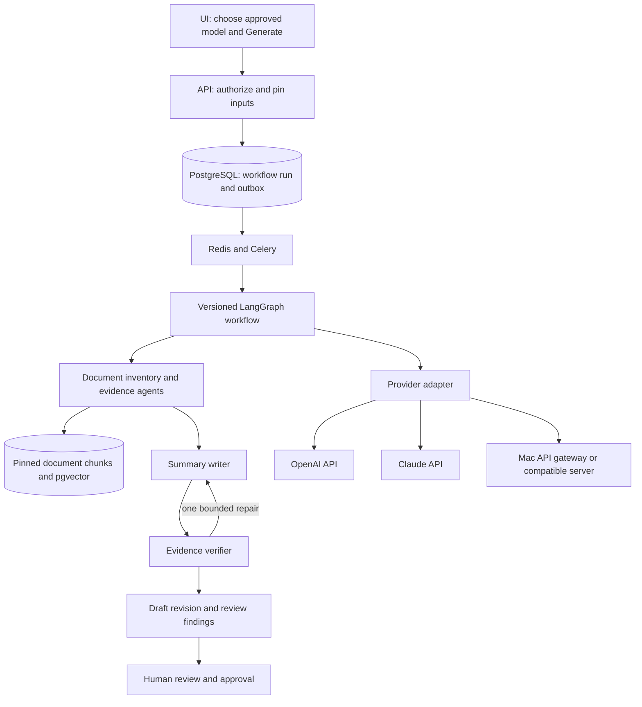

# Configurable agent workflows: summary implementation plan

Status: proposed implementation plan, 2026-10-27. This document does not enable
LLM calls, provision providers, or change the live deployment.

Step-by-step implementation documents are in the
[implementation step index](agentic-summary-generation-steps/README.md).
It expands this design into 15 ordered steps with individual tasks, verification,
and exit criteria; WBS/validation remain a separate deferred roadmap.

## 1. Confirmed scope and decisions

- Implement agentic document summaries first, for native text tender/RFP PDFs.
- Design reusable orchestration for later WBS generation and WBS validation.
- Tenant administrators manage provider connections, API keys, and approved model
  profiles. Authorized users choose an approved profile when generating a summary.
- The demo must support OpenAI and Llama 8B running on a Mac. Claude and custom
  OpenAI-compatible endpoints are part of the provider design and implementation.
- The Mac is exposed through a public API gateway. Its exact protocol, model ID,
  context limit, HTTPS/authentication settings, and availability need verification.
  Do not assume that an API gateway implements the entire OpenAI API.
- Produce a structured tender/RFP summary with requirements and page citations.
- Keep Neon/pgvector, existing BGE 384-dimensional embeddings, S3, Redis, Celery,
  existing authentication, and the current document-ingestion boundary.
- Keep Oracle Document Understanding as a later extraction improvement.
- Every generated summary remains a draft until a human approves a specific revision.

The application agents are logical roles within a workflow. They do not require
separate VMs, separate LLM instances, or one Celery worker per role.

## 2. What exists, and what must change

| Current implementation | Consequence for this work |
| --- | --- |
| `app/services/workflows.py::process_document_summary` emits placeholder text and an example requirement | Replace this path with real grounded generation; never return placeholder success when a provider is unavailable |
| Summary routes already queue jobs and support editing/approval | Extend these contracts rather than introduce a second unrelated summary feature |
| `document_summaries` has one mutable row per document | Add immutable run/revision history and an active-revision pointer |
| `HybridRetriever` combines vector and lexical candidates with reranking | Reuse it for targeted evidence lookup, not as the entire long-document summarizer |
| `active_search_candidates` resolves the current processing run on each call | Add explicit pinned-run reads so a workflow cannot mix old and newly ingested chunks |
| Ingestion dispatch has a durable outbox with ingestion-specific foreign keys | Add a workflow outbox; do not loosen ingestion constraints to force summaries into that table |
| Current summary dispatch publishes after the job commit without that outbox | Close the commit/publish failure window for the new summary workflow |
| UI presents three flattened text sections, empty page lists, and a hard-coded `confidenceScore: 85` | Add structured sections/citations and remove the fabricated confidence percentage |
| The summary editor limits each section to 2,000 characters and aligns requirements by array position | Replace with bounded structured editing and stable IDs; edits must not silently move citations between requirements |
| The deployed model worker has one processing slot and packages BGE/reranker artifacts | Reuse loaded retrieval models for the demo; do not duplicate their memory footprint without a resource test |

The accepted 85% Recall@5 result on the existing 20-question document benchmark
is a retrieval result. It does not establish summary factual accuracy or coverage.

## 3. Architecture

Use LangGraph for explicit state transitions, bounded tool loops, checkpoints,
and recovery. Keep application provider adapters, permissions, budgets, facts,
and output schemas independent of the graph framework. This is an engineering
recommendation, not a dependency already present in the repository.

Celery delivers work; PostgreSQL owns durable workflow state. A broker result or
an in-memory graph must never be the only copy of a completed summary step.
Before adopting a checkpointer, prove tenant isolation and recovery in a spike:
bind its operations to server-created tenant/run identities and transactions.
Do not rely on a guess-resistant graph thread ID as authorization. Migrations
must provision checkpoint tables; runtime roles must not auto-create schemas.

## 4. Provider connections and model profiles

Separate a **connection** (endpoint and credentials) from a **model profile**
(model, verified capabilities, generation settings, and limits). One connection
can expose several approved models without duplicating its API key.

| Connection field | Behavior |
| --- | --- |
| Name and provider | Friendly name; OpenAI, Anthropic, or OpenAI-compatible |
| API format | Responses, Anthropic Messages, or Chat Completions; selected by adapter |
| Base URL | Provider preset or an administrator-approved custom HTTPS gateway |
| Authentication | Provider-native header, Bearer token, or registered gateway auth scheme |
| API key/credential | Write-only input; store encrypted; show configured/masked status |
| Approved endpoint policy | Exact host/port/path prefix and server-side egress validation |
| Enabled state and credential version | Disable, rotate, and audit without exposing previous keys |
| Connection test | Synthetic request, reachable from the worker; no document content |

| Model-profile field | Behavior |
| --- | --- |
| Model ID | Exact provider/server identifier; manual entry allowed when discovery is unavailable |
| Connection ID | References the saved connection, not a browser-supplied raw endpoint |
| Allowed workflows | Summary initially; WBS/validation become separate future capabilities |
| Context window and maximum output | Conservative verified values, not an assumed marketing limit |
| Structured output/tool support | Capability-test result with timestamp and profile version |
| Temperature and other sampling settings | Only expose settings supported by that provider/model |
| Request and run limits | Timeouts, retries, concurrency, total calls/tokens, and optional cost ceiling |
| Default and enabled state | Tenant-scoped default; keep historical versions immutable |

Do not hard-code an OpenAI or Claude model name into workflow nodes. The UI must
allow an administrator to enter an accessible model ID and test it. A model list
endpoint is helpful when available, but absence of that endpoint is not proof
that inference is unsupported.

Initial adapter behavior:

| Provider | API integration | Structured results |
| --- | --- | --- |
| OpenAI | Native Responses API | Provider structured outputs where supported, then Pydantic validation |
| Anthropic/Claude | Native Messages API | Supported structured outputs/tool schemas, normalized into the same application contract |
| Mac Llama 8B | Prefer the gateway's verified OpenAI-compatible Chat Completions API | JSON schema when supported; otherwise bounded JSON-action/result validation and one repair |
| Custom compatible model | Same compatible adapter, registered endpoint and model profile | Only capabilities actually demonstrated by its connection test |

An arbitrary proprietary REST API is not automatically OpenAI-compatible.
Supporting a different request/response protocol requires a registered adapter;
the UI must not execute administrator-supplied Python or JavaScript mappings.

Provider-specific settings belong behind adapters: token-limit field names,
system messages, tool-call formats, refusals, truncation, usage, and unsupported
parameters differ. Do not send a universal bag of settings to every provider.

Changing the generation model does **not** change document embeddings, pgvector
dimensions, BGE query embeddings, or require re-ingestion.

## 5. UI and access model

Add **Settings → AI Models**, separate from member administration:

1. Administrator creates a connection and enters the secret once.
2. Administrator tests connectivity/authentication, then a small schema request.
3. Administrator creates a model profile, reviews supported settings, and enables it.
4. Editor selects an enabled profile before starting or regenerating a summary.
5. The run records which provider/model/profile version was used and displays it
   with progress, timing, usage, and any review findings.

Add explicit `llm:manage`, `llm:use`, and model-usage/audit permissions instead of
reusing `member:read`. Recommended mapping: administrators manage/use; editors
use with `summary:update`; viewers read summaries only. Backend checks are
mandatory even when the UI hides controls.

The Mac gateway's URL is called by the Oracle worker, not by the user's browser.
`localhost` in this configuration means the Oracle environment, not the Mac.
Use the reachable public gateway URL. Require valid HTTPS and authenticated
access for that public endpoint; do not disable certificate verification.

Keep API keys out of `VITE_*`, localStorage, URLs, job payloads, checkpoints,
tracebacks, and ordinary logs. Browser requests send a connection/profile ID.
No provider key or provider SDK needs to ship with the React bundle.

## 6. Summary workflow and agent responsibilities

### A. Validate, pin, and inventory — deterministic controller

- Authorize the user and document; require a completed, readable ingestion run.
- Pin tenant/project/document, processing-run ID, source hash, model-profile
  version, prompt/schema/workflow versions, and budget policy.
- Inventory all source sections, primary chunks, page ranges, tables, and glossary.
- Partition every primary chunk into a bounded reading batch. Preserve adjacent
  clauses, table headers/rows, units, qualifications, and source metadata.
- Track which batches were actually processed. A limit that leaves source unread
  produces an explicit partial/review-required result, never a complete label.

### B. Evidence analyst agent — repeated for reading batches

Extract typed candidate facts and requirements from each assigned batch. It may
request bounded additional evidence through these tools:

- `search_document(query, section_filter)` — hybrid retrieval within the pinned run.
- `read_section(section_id, cursor)` — bounded sequential section content.
- `read_chunk_neighbors(chunk_ids, radius)` — resolve clause/table context.
- `lookup_definition(term)` — scoped glossary evidence.

The server injects document scope; the model cannot choose another tenant or
document. Native tool calls and schema-validated JSON action requests normalize
to these same tools, allowing small models without dependable native tool use.

The agent chooses what additional evidence to request and whether a gap remains;
the controller decides limits and legal transitions. No arbitrary SQL, external
browsing, shell, file access, or unrestricted HTTP tool is available.

### C. Consolidation and targeted gap resolution

Deduplicate section findings into a fact/requirement register. Retain conflicting
values, alternatives, and conditions as separate qualified findings. Identify
missing tender categories and retrieve focused evidence, with neighboring text
where needed. An empty search result means unresolved/not found, not proof that
the document contains no such requirement.

For a long RFP, this is a hierarchical process: chunk batches → section notes →
document register. Do not concatenate all 391 chunks or all intermediate notes
into one model request. Detect and report truncation at every reduction stage.

### D. Summary writer agent

Generate a structured draft from the fact register and its source references.
Include executive overview, scope/deliverables, parties, eligibility, technical
requirements, dates/milestones, financial/commercial terms, securities/EMD/PBG,
submission/evaluation/award rules, obligations, exclusions, risks, conflicts, and
open questions. A missing category must remain explicitly unresolved.

### E. Evidence verifier agent plus deterministic checks

- Validate schema, scope, chunk IDs/hashes, quote spans, page bounds, and citations.
- Check numbers, currency, units, dates, ranges, conditions, and table relationships.
- Compare claims against supporting text and seek contradictory evidence.
- Produce concise findings with evidence, not a self-assigned confidence percentage.
- Permit at most one writer repair pass, then revalidate affected claims.
- Keep unsupported critical claims out of the accepted draft; show unresolved
  findings for human review or mark the run quality-blocked as appropriate.

A second LLM role is not independent proof of correctness, particularly when it
uses the same model. Citation validity alone also does not prove entailment.
Human review remains mandatory, and known facts need a source-grounded evaluation.

### F. Publish draft and human review

Publish an immutable machine-generated revision only if lifecycle/run checks
still pass. Show supported facts, missing information, conflicts, coverage, and
citations. Editing creates another revision and invalidates approval. Human-added
or changed claims are marked as edits requiring review; they must not inherit a
machine-verified badge automatically. Approval targets an exact revision and
processing run, with optimistic concurrency to prevent approving stale content.
For downstream use, require complete input coverage and no unresolved critical
verification failures. A field that remains not found after complete review may
be explicitly marked unknown; it must not be replaced with an invented value.

## 7. Facts, citations, and WBS-ready output

Use a versioned `TenderSummary` schema with:

- Structured sections, executive text, and key points.
- Facts: stable ID, category, statement, original/normalized value, unit/currency,
  applicability/conditions, and supporting evidence IDs.
- Requirements: stable ID and display code, obligation, responsible party when
  stated, deliverable, acceptance criteria when stated, dependencies only when
  supported, and source evidence. Never infer schedule/durations as source facts.
- Risks/conflicts/open questions, including alternative tender options.
- Coverage: processed/total primary chunks, section coverage, unresolved fields,
  and explicit truncation/partial flags. Processing every chunk is not a claim
  that every relevant fact was extracted.
- Provenance: source/run hashes, model profile/model, prompt/workflow/schema versions,
  generation timestamp, usage, and human revision/approval metadata.

Each evidence record contains tenant/document/run identity, chunk ID and canonical
hash, physical PDF page number(s), heading path, exact bounded quote, validated
character offsets in canonical chunk text, and table/row identity when available.
Multiple source spans may support one claim. Display printed page labels separately
if present. The backend derives/checks locators instead of trusting model page numbers.

Citation clicks open an authenticated source view or a short-lived authorized
document URL; never expose a permanent public bucket link. Recheck document access
and deletion status when opening evidence. Keep cited context recognizable in tables.

Maintain the existing `summary_text`, `key_points`, and `requirements` fields as
a compatibility projection during UI migration. New UI writes must preserve the
typed schema and stable IDs instead of round-tripping it through three textareas.
Generated summaries are stored as structured records, not automatically embedded
back into pgvector in this phase.

## 8. Persistence and API changes

Proposed records, with tenant-scoped access, indexes, and appropriate composite
foreign keys/RLS consistent with the existing protected document tables:

| Record | Purpose |
| --- | --- |
| `llm_connections` and credential versions | Approved endpoint, adapter, encrypted credential, status |
| `llm_model_profiles` and immutable versions | Model settings, tested capabilities, workflow eligibility and budgets |
| `agent_workflow_runs` | Immutable input/profile snapshot, state, lease, versions, usage and outcome |
| `agent_step_runs` / scoped checkpoint records | Batch/node progress, validated artifacts and replay keys |
| `workflow_dispatch_outbox` | Transactional delivery and continuation/reconciliation for workflow jobs |
| `summary_revisions` | Machine/human revisions, structured output, quality findings and approvals |
| `summary_evidence` | Canonical source references linked to the revision/claims |

Extend `DocumentSummary` with an active revision pointer and compatibility view.
Keep original ingestion/vector tables intact. Checkpoint payloads contain only
required bounded artifacts; do not persist API keys or private chain-of-thought.

Endpoint sketch, under the existing `/api/v1` prefix:

- `GET/POST/PATCH /tenants/{tenant}/llm/connections` and an ID-scoped credential
  rotation action; all credential reads return metadata only.
- `POST /tenants/{tenant}/llm/connections/{id}/test`.
- `GET/POST/PATCH /tenants/{tenant}/llm/profiles`; return only usable metadata to editors.
- Extend existing `POST .../documents/{document}/summary` with `model_profile_id`,
  expected processing-run ID, and an idempotency key.
- Extend `GET .../summary` with structured revision, evidence, quality, and provenance.
- Add revision-scoped edit/approval/history and a permission-checked evidence reader.
- Reuse job polling; add run steps/progress, cancellation, and safe retry/resume.

Bind approval/edit requests to the revision ID and expected version. The current
API's mutable summary-ID-only approval is insufficient for concurrent regeneration.

## 9. Reliability, limits, and security

- Store provider secrets with authenticated encryption, key versioning, and tenant/
  connection identity as associated data. Keep the encryption key outside the DB
  in a separately managed runtime secret; back it up and test rotation/recovery.
- Validate custom endpoints against an approved egress policy, including DNS/IP
  resolution, redirects, and connection-time behavior. Deny metadata, loopback,
  internal admin services, credentials in URLs, and unchecked redirects. The Mac
  public gateway must be explicitly approved. A later private endpoint needs an
  operator-registered network exception, not a blanket private-network bypass.
- Treat uploaded document text as untrusted evidence, including instructions that
  ask the model to reveal secrets, switch tools, or change endpoint/scope.
- Pin the completed source run at start. Add pinned-run repository methods; do not
  silently switch to newly active chunks. If source activation changes, mark the
  result stale and require regeneration before approval/downstream use.
- Deletion/cancellation stops new provider calls and prevents late publication.
  Integrate summaries/evidence/checkpoints with existing deletion reconciliation;
  do not invent retention durations or enable destructive cleanup policies.
- Do not keep database transactions open across LLM/network calls. Use bounded
  leases, heartbeats, compare-and-swap updates, and checkpoint completed work.
- Make delivery/replay idempotent. A timed-out provider request can still incur a
  charge; checkpointing cannot guarantee exactly-once external billing.
- Retry only transient faults with bounded backoff. Treat auth/unsupported-model
  errors as configuration failures. Allow one schema repair and one evidence
  repair; set an overall ceiling so nested retries cannot multiply unboundedly.
- No automatic fallback from the Mac to a cloud provider. A user explicitly chooses
  a different approved profile and starts a new run with its own provenance.
- Separate sanitized operational events from document content. Disable automatic
  external content tracing; retain only approved bounded artifacts. User-facing
  traces show stages, evidence, and findings, not hidden internal reasoning.

Starting tuning values, subject to the actual Mac capability test and benchmark:
one provider call at a time for Llama, a conservative 8K context budget if verified,
approximately 3–5K source tokens per extraction batch, 1–2K output tokens, bounded
targeted retrieval, and at most 120 total model calls for the 110-page demo.
Make whole-run limits explicit and configurable by administrators. A 391-chunk
document may need roughly 50 or more map calls plus consolidation/review; do not
promise chat-like latency or silently cut coverage to fit a short demo.

Measure tokens with the provider/server tokenizer when available. Otherwise use
a conservative documented estimate, reserve prompt/output headroom, and handle
context-limit errors without silent truncation. Report actual provider usage when
available, otherwise label estimates/unknown usage. Cost estimates use the model
profile's maintained rates; do not label local inference as having zero resource cost.

## 10. Deployment strategy

For the initial demo, reuse the existing model-enabled Celery worker, one logical
processing slot, and the same retrieval process caches. Llama inference runs on
the Mac; OpenAI/Claude inference runs at their APIs. The Oracle VM does not host
an 8B model. No extra Beat scheduler or always-on agent process is required.

Add bounded summary execution/continuation tasks with checkpointed batches so a
long Mac request does not hold an entire database transaction or make ingestion
appear completed. Queue competing work visibly. Load-test summary plus ingestion
before permitting concurrency; existing memory limits are not an available-memory
guarantee. Avoid adding a second full BGE/reranker process just for summaries.

If later isolation is needed, split lightweight model orchestration from a shared
retrieval execution path using asynchronous tasks/checkpoints. Do not synchronously
wait for a child task on the same single-slot worker. Keep the public API lightweight
and provider credentials server-side. Package/pin orchestration/SDK dependencies
and run the ARM64 image checks before deploying.

## 11. Implementation phases and exit checks

| Phase | Deliverables | Exit check |
| --- | --- | --- |
| 0. Contracts and provider spike | Final schemas, node contracts, permissions, actual Mac API/latency/context/schema tests, LangGraph persistence spike | Same minimal typed extraction succeeds through OpenAI and the Mac gateway; protocol differences are documented |
| 1. Connections and UI configuration | Credential encryption, migrations, provider adapters, admin UI, profile selection and connection tests | Admin can configure providers; editor can select/use but cannot retrieve keys or change connections; isolation tests pass |
| 2. Durable workflow foundation | Run/profile snapshots, scoped checkpoints, workflow outbox, retries/cancellation and bounded continuation tasks | Crash/restart and duplicate-delivery tests preserve completed steps and avoid duplicate active revisions |
| 3. Evidence preparation | Pinned-run sequential reads, section/table coverage, scoped hybrid tools and context budgeting | Every primary chunk is accounted for or explicitly marked unprocessed; no mixed-run or cross-tenant evidence |
| 4. Summary agent graph | Analyst, consolidation, writer, verifier, bounded repair, typed requirements and citations | Both demo providers produce a validated draft with truthful unresolved findings |
| 5. Review experience | Structured sections, evidence viewer, stable-ID edits, history/provenance and revision-specific approval | User can inspect supporting pages, edit without moving evidence, regenerate, and approve the intended revision |
| 6. Evaluation and rollout | Gold tender facts, negative cases, provider comparison, timeout/load/fault tests, ARM build and operations notes | Proposed quality gates are reviewed, then a feature-gated live demo passes with both Mac Llama and OpenAI |

Evaluate on the supplied RFP plus a second different tender and small synthetic
fixtures. Include issuer, total/per-unit capacity, financial proposal unit counts,
PPA duration, both EMD options, eligibility, deadlines, conditional clauses,
conflicting values, tables, missing facts, and document-instruction attacks.
Keep private PDFs, extracted content, keys, and live responses out of Git/CI artifacts.

Proposed demo gates: 100% valid in-scope evidence locators for published claims;
no unsupported critical financial/date/capacity assertion presented as verified;
all source chunks accounted for; failures/partial coverage clearly surfaced;
and a separately measured initial target of at least 85% of annotated required
facts correct and cited for each provider. The last target is a proposal to review
after a pilot, not an extension of the previously accepted retrieval benchmark.
Measure citation entailment manually on the gold set and report coverage, omissions,
contradictions, schema failures, latency, retries, calls/tokens, and cost per provider.

Tests must cover encrypted key rotation, model/profile disabling, endpoint SSRF,
tenant isolation, stale/deleting source runs, cancellation, interrupted requests,
duplicate jobs, schema/refusal/truncation failures, revisions/approval races, and
actual Mac/OpenAI adapter contracts. Use fake providers and disposable databases
for CI; run small explicitly requested live-provider tests outside normal CI.

## 12. Later WBS and validation graphs

Reuse connections/profiles, run state, evidence tools, typed requirement IDs,
budget enforcement, review UI, and outbox/checkpoint infrastructure.

- WBS graph: approved summary revision + its source evidence → scope decomposition
  → work packages/dependencies → requirement coverage → human review.
- Validation graph: WBS revision + approved requirements + source evidence →
  deterministic structural rules + evidence/coverage analysis → findings and
  proposed corrections. LLM findings do not override deterministic failures.
- Pin all upstream revision IDs; never generate a WBS from an unapproved/stale
  summary. The source PDF remains authoritative: future WBS agents can request
  scoped evidence rather than assume the summary contains every requirement.
- Start with one selected model per summary run for understandable demo comparisons.
  Later add explicit per-role model assignments, still versioned and budgeted.
- Do not implement WBS/validation agents or auto-publish their outputs in this phase.

## 13. Inputs needed when implementation starts

Enter secrets through the new settings flow or a secure runtime channel, not chat.
Collect the Mac gateway's base URL, protocol/auth scheme, model ID, context/output
limits and health availability; select an accessible OpenAI model/API project;
and set a demo call/token/cost budget. Confirm any provider-specific restrictions
with connection tests. These details need not block building the provider-neutral
contracts and fake-provider workflow tests.

## Official implementation references

- [OpenAI Responses API](https://developers.openai.com/api/reference/responses/overview)
  and [structured outputs](https://developers.openai.com/api/docs/guides/structured-outputs).
- [Claude structured outputs](https://platform.claude.com/docs/en/build-with-claude/structured-outputs).
- [Ollama OpenAI compatibility](https://docs.ollama.com/api/openai-compatibility)
  and [structured outputs](https://docs.ollama.com/capabilities/structured-outputs).
  These establish available integration options, not the capabilities of the
  user's gateway, whose underlying server is not yet identified.
- [LangGraph persistence](https://docs.langchain.com/oss/python/langgraph/persistence).

Provider features and SDK versions must be checked again and pinned during
implementation. The architectural decisions and proposed limits above are this
project's design, not promises made by those providers.
