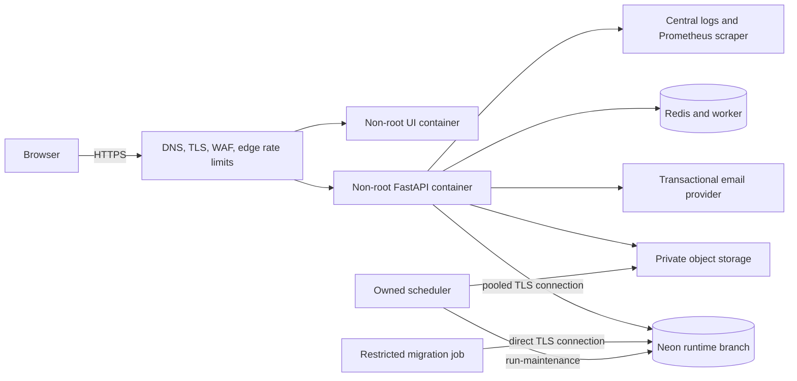

# Phase 8 Architecture and Environments

## Production request path

The public edge terminates TLS, replaces untrusted forwarding headers, enforces request limits, and
routes only the metrics allowlist to the API metrics endpoint. The API trusts only the CIDRs in
`FORWARDED_ALLOW_IPS`. Runtime database traffic uses the pooled credential; only the migration job
receives `DIRECT_DATABASE_URL`. The UI receives public `VITE_*` build values and no runtime secret.

## Environment isolation

| Concern | Staging | Production |
| --- | --- | --- |
| UI/API hosts | Separate staging domains | Approved production domains |
| Neon | Dedicated staging branch/project | Dedicated production branch/project |
| Credentials | Staging-only runtime/migration identities | Production-only least-privilege identities |
| Email | Test recipient policy and staging sender | Verified production sender/domain |
| Object storage | Separate bucket/prefix and key | Separate bucket/prefix and key |
| Telemetry | Staging dataset and alerts | Production dataset and owned paging route |
| Secrets | Staging scope | Production scope with break-glass audit |

Never run Phase 7 destructive test seeding against either shared environment. Use an isolated,
disposable database as enforced by the test harness.

## Platform decisions

These decisions cannot be made by repository code and block Phase 8 completion.

| Decision | Required approver | Status | Evidence to attach |
| --- | --- | --- | --- |
| UI/API hosting and regions | Engineering + Operations | Pending | Approved architecture record |
| DNS, TLS termination, and certificates | Operations + Security | Pending | External TLS scan |
| Secret manager and workload identity | Security + Operations | Pending | Access policy export |
| WAF/edge rate-limit provider | Security | Pending | Active policy export and tests |
| Logs, metrics, traces, paging | Operations | Pending | Dashboard and alert test links |
| Transactional email provider | Product + Security | Pending | Sender verification and test evidence |
| Backup/restore owner and objectives | Data owner + Operations | Pending | Successful restore record |
| Auth-event retention/privacy policy | Privacy + Security | Pending | Approved retention decision |
| On-call and escalation path | Operations | Pending | Published schedule/escalation policy |
| Staging/production Neon projects | Database owner | Pending | Project/branch references, no secrets |

## Repository deployment references

- API image: `backend/Dockerfile`
- UI image and CSP server: `WBS_UI/Dockerfile`, `WBS_UI/nginx.default.conf.template`
- production value inventory: `deploy/production.env.example`
- edge policy reference: `deploy/edge/nginx.conf.example`
- release gates and SBOM: `.github/workflows/fullstack-security.yml`
